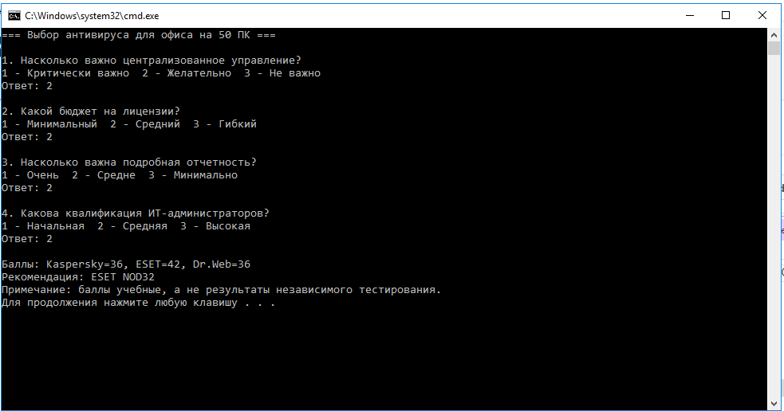
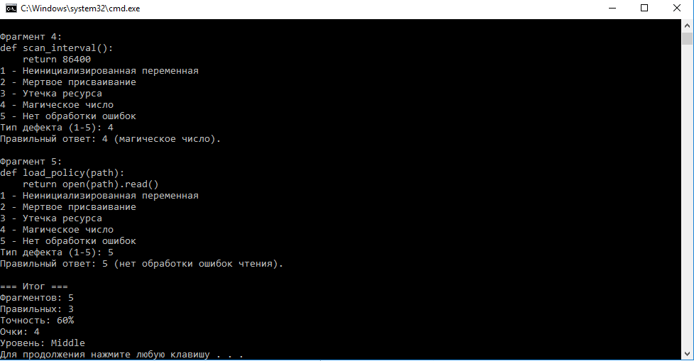
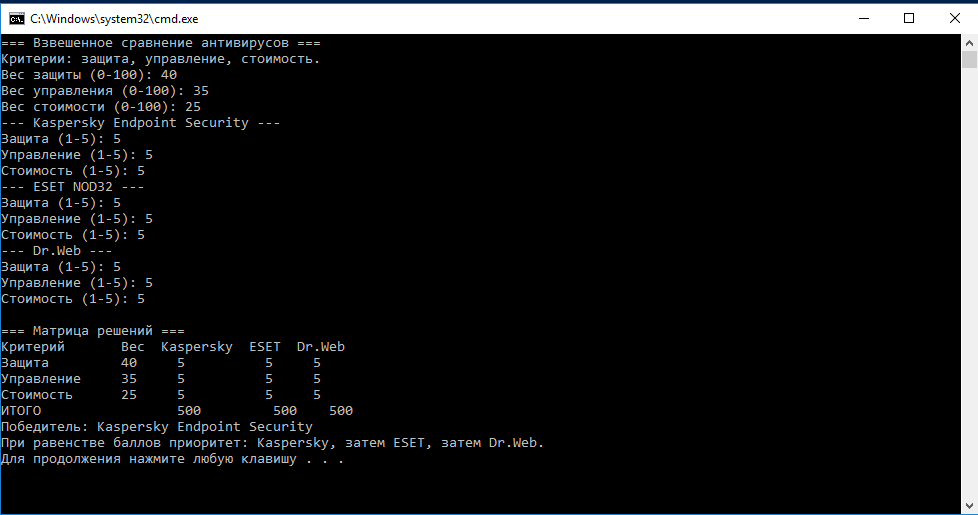
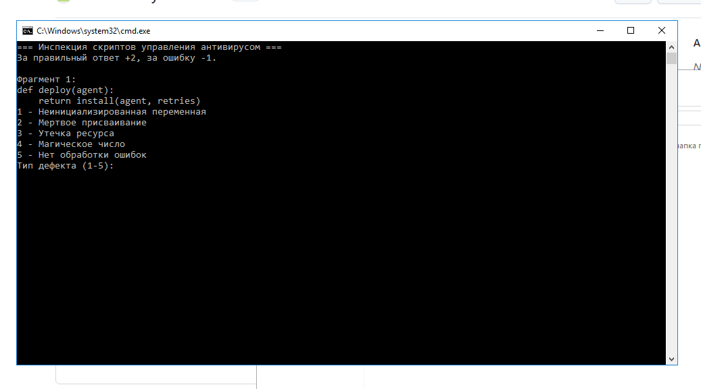
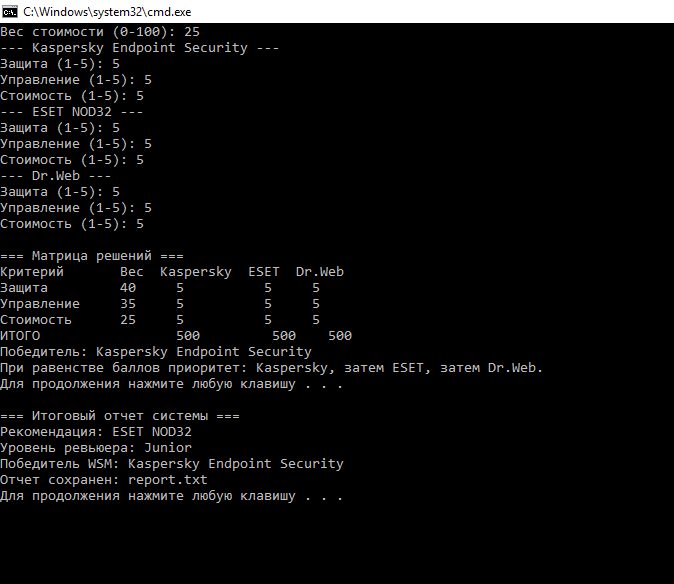

# Лабораторная работа №2 — вариант 8

**Тема:** моделирование принятия решений при выборе антивирусного решения для организации.

**Студент:** Воронцов Артем  
**Группа:** 3525П1ИН3  
**Репозиторий GitHub:** https://github.com/Temick2/Laboratornaya-rabota-2

## Условия
Офис на 50 рабочих станций, необходимо централизованное управление. Альтернативы: Kaspersky Endpoint Security, ESET NOD32, Dr.Web.

## Состав проекта и листинг
- [`chapter1.bat`](chapter1.bat) — интерактивная оценка кандидатов. Команды `choice`, `if`, `goto`, `set /a` начисляют баллы по ответам о централизованном управлении, бюджете, отчетности и квалификации администратора. Побеждает максимальная сумма.
- [`chapter2.bat`](chapter2.bat) — пять учебных фрагментов Python по администрированию антивируса; определение типов дефектов, очки +2/-1, процент правильных ответов и уровень Junior/Middle/Senior.
- [`chapter3.bat`](chapter3.bat) — пользователь вводит веса трех критериев (в сумме 100) и оценки каждого продукта от 1 до 5. Взвешенная сумма вычисляется как `S = W1*X1 + W2*X2 + W3*X3`; выводятся матрица и победитель.
- [`lab_system.bat`](lab_system.bat) — главное меню, вызовы `call`, последовательный запуск и сохранение `report.txt`.

Полный исполняемый листинг каждого модуля доступен по ссылкам выше. Все оценки и правила начисления баллов — **учебная модель**, а не реальные результаты тестирования антивирусов или коммерческие предложения.

## Как запустить
1. Скачать репозиторий: **Code → Download ZIP** и распаковать.
2. На Windows открыть `lab_system.bat` двойным кликом.
3. Выбрать пункт 1, 2, 3 или 4. Для полного прогона выбрать **4**.
4. Отвечать на вопросы с клавиатуры; после каждого модуля нажать любую клавишу.
5. После пункта 4 открыть `report.txt` рядом с BAT-файлами.

## Результаты и скриншоты 

### Модуль 1
**Диалоги:** важность централизованного управления, бюджет, отчетность, квалификация ИТ-администраторов.  
**Полученная рекомендация:** ESET NOD32.  
**Скриншот:** 

### Модуль 2
**Диалоги:** пять фрагментов кода; нужно определить тип дефекта.  
**Уровень ревьюера:** Middle.  
**Скриншот:** 

### Модуль 3
**Диалоги:** ввод весов критериев и оценок продуктов; вывод матрицы WSM.  
**Победитель:** Kaspersky.  
**Скриншот:** 

### Интегрированная система
**Главное меню:**   
**Последовательное прохождение (пункт 4):** 
**Итоговый отчет:** `report.txt` содержит рекомендацию, уровень ревьюера, точность и победителя WSM.  
**Скриншот итогового отчёта:**

